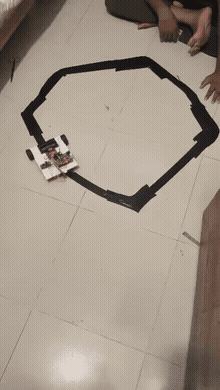
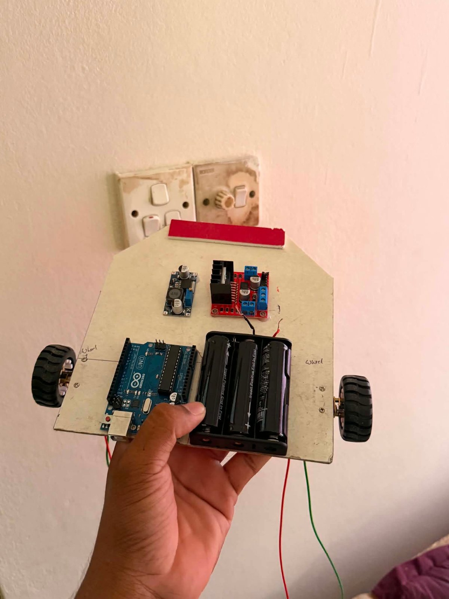
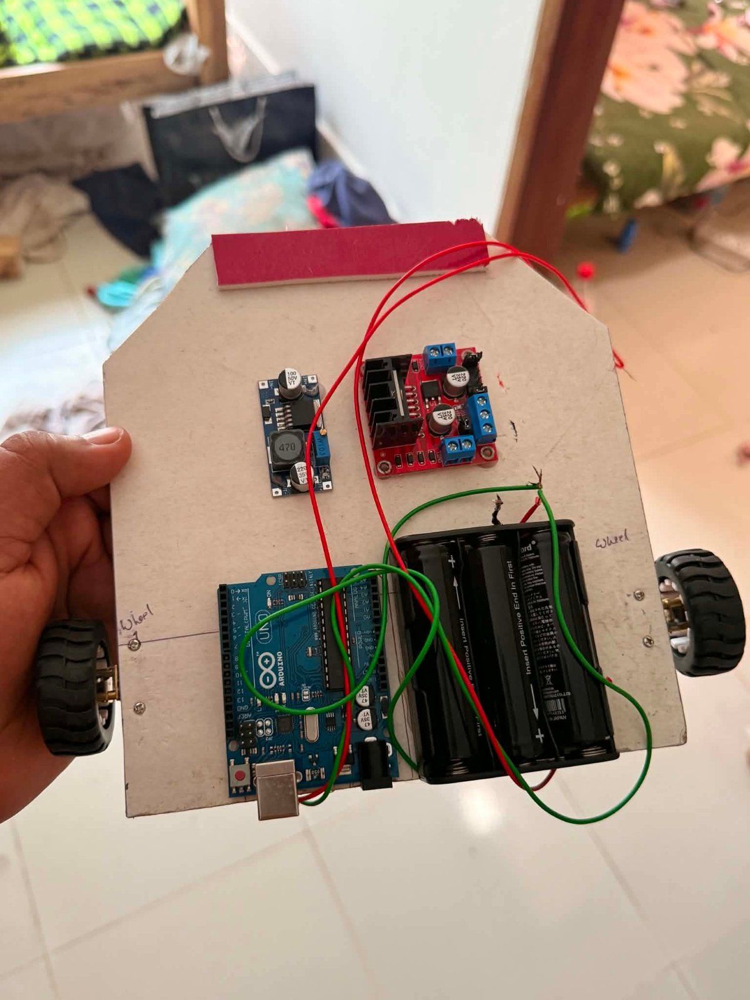

# 🤖 2-Wheel Autonomous Line Follower Robot

An Arduino Uno based robot car that follows a black line on the floor completely on its own — no remote, no external control. Built as a final lab project (A4 topic) by **Mahamud Hassan**.

<p align="center">
  
</p>

> Full video: [`demo.mp4`](demo.mp4) · Full report (Bangla, 10 pages): [`Line_Follower_Robot_Report.pdf`](Line_Follower_Robot_Report.pdf)

## ✨ Features

- Autonomous navigation along a black line (straight, gentle turns, sharp turns)
- PWM speed control through an L298N driver
- **Line memory** – if the line is lost, the robot turns toward the side where it last saw the line
- Stable 5 V logic supply from a 7.4 V battery pack via an LM2596 buck converter
- Two firmware versions: simple 5-sensor digital logic (v1) and 8-sensor proportional control (v2)

## 📸 Hardware

|                                              |                                              |
| -------------------------------------------- | -------------------------------------------- |
|  |  |

### Components

| Component                                         | Role                                                 |
| ------------------------------------------------- | ---------------------------------------------------- |
| Arduino Uno R3                                    | Main controller                                      |
| IR line sensor array (5-ch in v1, 8-ch QTR in v2) | Detects black line vs. white floor                   |
| L298N motor driver                                | Drives the motors with PWM speed + direction control |
| 2 × N20 1000 RPM gear motors + wheels             | Locomotion                                           |
| 2 × 18650 Li-ion (3.7 V) in series = 7.4 V        | Power source                                         |
| LM2596 buck converter                             | 7.4 V → 5 V for the Arduino                          |
| ON/OFF switch                                     | Main power switch                                    |
| Brackets, jumper wires, tape                      | Mounting and wiring                                  |

### Block diagram

```
 2×18650 (7.4V) ──► Switch ─┬──► L298N ──► 2× N20 motors
                            └──► LM2596 ──5V──► Arduino Uno ◄── IR sensor array
                                                    │
                                                    └── control + PWM ──► L298N
```

## 🔌 Wiring

### v1 — 5-channel digital IR array ([firmware](line_follower_5ir.ino))

| Signal                       | Arduino pin |
| ---------------------------- | ----------- |
| Sensor 1 (far left)          | D2          |
| Sensor 2 (near left)         | D3          |
| Sensor 3 (center)            | D4          |
| Sensor 4 (near right)        | D5          |
| Sensor 5 (far right)         | D6          |
| L298N ENA (left speed, PWM)  | D9          |
| L298N IN1 / IN2              | D7 / D8     |
| L298N IN3 / IN4              | D11 / D12   |
| L298N ENB (right speed, PWM) | D10         |

### v2 — 8-channel QTR (RC) array ([firmware](line_follower_qtr8.ino))

| Signal                      | Arduino pin                    |
| --------------------------- | ------------------------------ |
| QTR sensors 1–8             | A0, A1, A2, A3, A4, A5, D2, D3 |
| L298N ENA / ENB (PWM)       | D5 / D6                        |
| L298N IN1 / IN2 / IN3 / IN4 | D7 / D8 / D9 / D10             |

### Power

- Battery 1 (+) → switch → L298N 12 V terminal **and** LM2596 IN+
- Battery 1 (−) → Battery 2 (+) (series, 7.4 V); Battery 2 (−) → common GND
- LM2596 OUT → Arduino 5 V / GND (set it to **5 V with a multimeter first**)
- Arduino, sensors and L298N **must share a common GND**
- Remove the ENA / ENB jumpers on the L298N so PWM speed control works

## 🧠 How it works

**v1 – rule based (5 digital sensors).** Each loop reads the 5 sensors and picks a rule:

| Situation                        | Left wheel                                         | Right wheel |
| -------------------------------- | -------------------------------------------------- | ----------- |
| Center on line                   | 70                                                 | 70          |
| Near-left sensor on line         | 25                                                 | 70          |
| Far-left sensor on line (sharp)  | 0                                                  | 85          |
| Near-right sensor on line        | 70                                                 | 25          |
| Far-right sensor on line (sharp) | 85                                                 | 0           |
| Line lost                        | search toward last seen side, or stop if no memory |             |

**v2 – proportional control (8 QTR sensors).** `readLineBlack()` returns a line position from 0 to 7000. The error from the center (3500) is multiplied by `Kp` and added to / subtracted from the base speed of each wheel, giving smooth steering instead of hard rule switching. 400 calibration passes run at start-up (the on-board LED is on during calibration).

```
error      = position - 3500
correction = Kp * error
left  = base + correction
right = base - correction
```

## 🚀 Getting started

1. Build the circuit as in the wiring tables above.
2. Open the `.ino` file of the version you built in the Arduino IDE.
   - v2 needs the **QTRSensors** library by Pololu (_Sketch → Include Library → Manage Libraries_).
3. Select **Arduino Uno** and the right port, then upload.
4. Place the robot on a black-tape track (a white floor works best). v1 waits 3 s after power-on so you can place it; v2 calibrates first.

### Tuning tips

- Robot wobbles → lower `Kp` (v2) or lower the speeds.
- Robot leaves the track in curves → raise `Kp` or lower `baseSpeed`.
- Robot runs away from the line → your sensor output is inverted; swap `HIGH`/`LOW` (v1) or use `readLineWhite` (v2).

## 📁 Repository files

```
.
├── line_follower_5ir.ino          # v1 firmware (5 digital IR sensors)
├── line_follower_qtr8.ino         # v2 firmware (8-sensor QTR, proportional control)
├── Line_Follower_Robot_Report.pdf # full project report
├── demo.mp4 / demo.gif            # demo video
├── robot_top_view_1.jpg           # photos
├── robot_top_view_2.jpg
├── LICENSE
└── README.md
```

## 🔮 Future improvements

- Full PID (add `Ki`, `Kd`) for higher speed
- Encoders for speed feedback
- Intersection / junction handling
- Custom PCB instead of jumper wires

## 🙏 Credits

Author: **Mahamud Hassan**

## 📄 License

[MIT](LICENSE)

---
